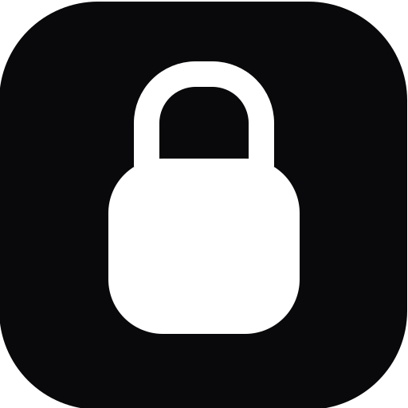
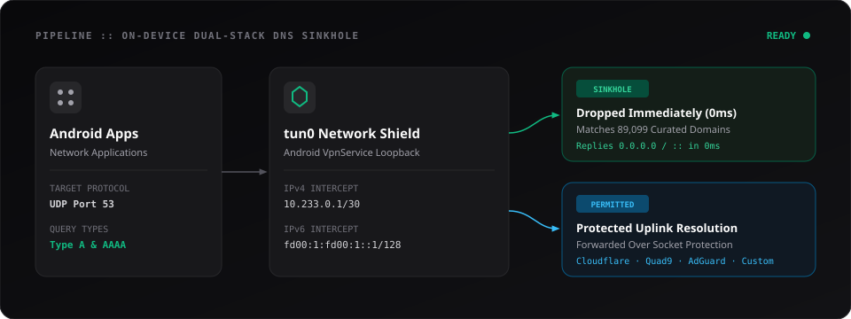

<p align="center">
  <picture>
    <source media="(prefers-color-scheme: dark)" srcset="art/buni-logo-dark.svg">
    <source media="(prefers-color-scheme: light)" srcset="art/buni-logo-light.svg">
    
  </picture>
</p>

<h1 align="center">buni</h1>

<p align="center">
  <b>The hidden network shield.</b>
</p>

<p align="center">
  <a href="https://github.com/muadzhdz/buni/releases"></a>
  <a href="https://developer.android.com"></a>
  <a href="https://kotlinlang.org"></a>
  <a href="https://developer.android.com/jetpack/compose"></a>
  <a href="LICENSE"></a>
</p>

---

## Overview

**Buni** is a lightweight, defensive, on-device network privacy shield and in-memory DNS sinkhole for Android.

Operating **100% locally on your device** without root privileges, Buni establishes a loopback tunnel via Android `VpnService` that intercepts only UDP port 53 DNS traffic across both IPv4 and IPv6. Queries matching blocklist rules are dropped instantly at 0ms latency with synthetic responses (`0.0.0.0` / `::`), preventing ads, OEM telemetry, and invasive mobile trackers from ever leaving your device.

---

## Architecture

<p align="center">
  <picture>
    <source media="(prefers-color-scheme: dark)" srcset="art/buni-architecture-dark.svg">
    <source media="(prefers-color-scheme: light)" srcset="art/buni-architecture-light.svg">
    
  </picture>
</p>

- **Dual-Stack DNS Sinkhole**: Intercepts UDP port 53 traffic routed to `10.233.0.2/32` (IPv4) and `fd00:1:fd00:1::2/128` (IPv6) with RFC 8200 checksum calculation to prevent carrier IPv6 DNS leaks.
- **89,099 Curated Rules**: High-density blocking for OEM vendor bloatware (ColorOS, MIUI, OriginOS, One UI, HiOS) and mobile ad SDKs (AdMob, UnityAds, AppLovin, ironSource, Pangle, InMobi).
- **Private DNS Guard**: Detects Android 9+ Private DNS (DNS-over-TLS on port 853) bypass and alerts users directly on the dashboard with 1-tap system settings access.
- **Protected Resolver Uplink**: Permitted queries resolve through protected sockets via DNS-over-HTTPS (DoH / RFC 8484) or upstream resolvers (Cloudflare, Quad9, AdGuard, Google, Custom).
- **Per-App Bypass**: Granular control to exempt specific applications directly to WAN without filtering.
- **Adaptive Contrast Theme**: Obsidian dark and daylight zinc themes with dynamic status bar and navigation bar contrast synchronization.

---

## Building from Source

### Prerequisites
- JDK 17+
- Android SDK (API 35, Build-Tools 35.0.0+)
- Pure JVM / Zero NDK required

```bash
git clone https://github.com/muadzhdz/buni.git
cd buni/android
./gradlew assembleRelease
```

The output APK will be located at:
`android/app/build/outputs/apk/release/app-release.apk`

---

## Standalone Development Engine

A standalone Go DNS filtering engine and CLI harness is available under `core/`:

```bash
cd core
go test -v -race ./...
go run ./cmd/buni-dev
```

---

## License

This project is licensed under the **GNU General Public License v3.0** (GPL-3.0-or-later). See the [LICENSE](LICENSE) file for the full license text.
